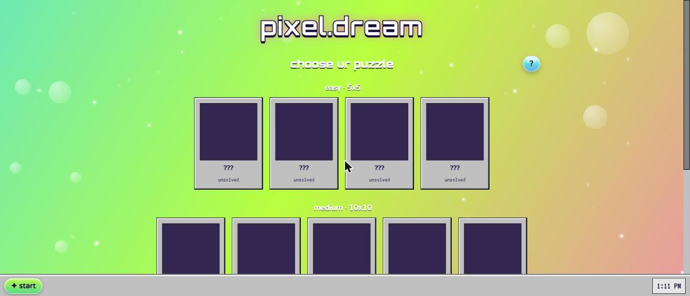
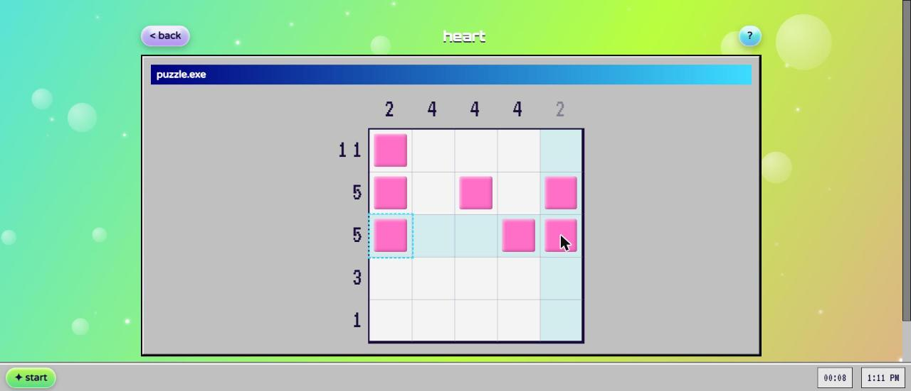
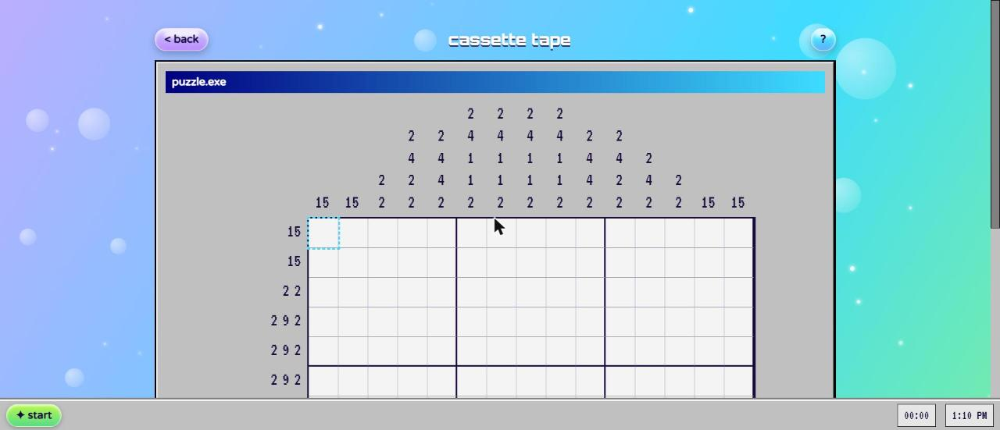

# pixel.dream

A Y2K-themed Nonogram (Picross) puzzle game: glossy buttons, Windows 98 chrome,
a holographic background and sparkle cursor. Fill in the grid using the row and
column clues to reveal the hidden pixel art.

Built with Vite, React 19, TypeScript, Tailwind CSS, Framer Motion and Zustand,
with hand-rolled Web Audio sound effects. There is no backend; progress is saved
to `localStorage`.



| 5x5 puzzle in progress | 15x15 puzzle |
| --- | --- |
|  |  |

## Features

- 12 puzzles across three sizes: easy (5x5), medium (10x10) and hard (15x15)
- Pixel art is hidden until you solve a puzzle; the menu shows your best times
- Row and column clues dim as each line is satisfied
- Fill and mark-as-empty (X) modes, drag to paint a line, undo and redo
- Check button (costs 30 seconds) and a reset with confirmation
- Interactive tutorial and a tabbed how-to-play window
- Keyboard play (arrow keys, space to fill, `X` to mark, Ctrl+Z / Ctrl+Y) and
  touch support with a fill/mark toggle
- Sound effects that can be muted from the taskbar start menu

## Run locally

```bash
npm install
npm run dev
```

Open the printed `http://localhost:5173` URL (or whichever port Vite picks).

## Controls

| Action | Mouse / touch | Keyboard |
| --- | --- | --- |
| Fill a cell | Left click (or tap in fill mode) | Space |
| Mark a cell empty | Right click (or tap in mark mode) | X |
| Fill or mark a line | Click and drag along a row or column | |
| Move | | Arrow keys |
| Undo / redo | Buttons | Ctrl+Z / Ctrl+Y |

## Scripts

| Command | What it does |
| --- | --- |
| `npm run dev` | Start the dev server |
| `npm run build` | Type-check and build a static site to `dist/` |
| `npm run preview` | Serve the production build locally |
| `npm run lint` | Lint with oxlint |

`npm run build` outputs a static site to `dist/`; deploy that folder as-is to
Vercel, Netlify, GitHub Pages or any static host. No environment variables or
server-side code are required.

## Project structure

```
src/
  components/   UI components (Board, Cell, Window98, HowToPlay, Tutorial, ...)
  game/         puzzle data, clue/win logic, the line-solver, zustand store
  audio/        Web Audio sound effect generators
  hooks/        timer + localStorage hooks
docs/           README screenshots
```

## Puzzle data and solver

All 12 puzzles (plus the tutorial puzzle) are verified at dev-server startup by
a logic-only line solver (`src/game/solver.ts`). Check the browser console for
`[pixel.dream] puzzle "<id>" verified unique + logic-solvable.` for each one. If
a puzzle's pixel art is ever edited, watch that log to make sure it still has a
unique, non-guessing solution.

## Notes

- Sound only starts after the first user interaction (browser autoplay policy)
  and can be muted from the taskbar start menu.
- Progress (solved puzzles, best times, in-progress boards, sound setting,
  tutorial completion, "don't show how to play again") is stored under the
  `pixel-dream-progress-v1` localStorage key.
